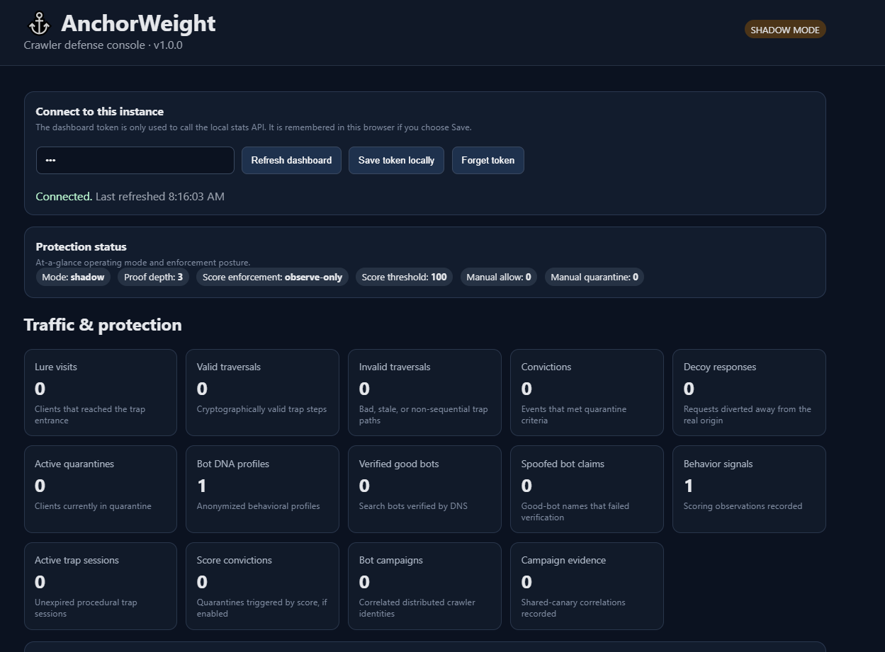

# AnchorWeight v3.1.0

**Self-hosted defensive reverse proxy and crawler/AI-agent identification platform with Proof-of-Crawl, privacy-minimized observability, shadow-first policy controls, and bounded enforcement.**

> **Let bots identify themselves.**

[](https://github.com/fuhrdan/AnchorWeight/actions/workflows/ci.yml)
[](https://github.com/fuhrdan/AnchorWeight/actions/workflows/codeql.yml)
[](https://nodejs.org/)
[](LICENSE)
[](V3.1.0-RELEASE-NOTES.md)

AnchorWeight sits in front of a web application, observes crawler and automation behavior, gathers explainable evidence, and lets an operator decide what—if anything—should be enforced.

It is built around a deliberate separation:

```text
Observation
    ↓
Evidence
    ↓
Assessment
    ↓
Policy
    ↓
Enforcement
```

A suspicious signal is **not automatically a block**.



---

## Why AnchorWeight?

Traditional bot controls often depend heavily on IP reputation, static User-Agent lists, or one opaque score. AnchorWeight takes a different approach:

- expose bounded opportunities for automation to identify itself;
- verify what can be independently verified;
- observe behavior over time;
- keep automation confidence separate from policy risk and resource pressure;
- default new controls to Shadow Mode;
- preserve a clear operator decision before enforcement.

The maze is not the weapon. **The maze is the test.**

AnchorWeight is intentionally **not** an infinite tarpit, bandwidth sink, connection-exhaustion system, huge-file generator, or offensive countermeasure.

---

## v3.1.0: AI-agent controls

v3.1.0 adds an explicit control plane for modern AI crawlers and user-directed agents while preserving the shadow-first safety model used throughout v3.

Recognized families include published identifiers associated with:

- **OpenAI** — GPTBot, OAI-SearchBot, ChatGPT-User, OAI-AdsBot
- **Anthropic** — ClaudeBot, Claude-SearchBot, Claude-User
- **Perplexity** — PerplexityBot, Perplexity-User
- **Google** — supported AI/user-agent families and provider network categories

AnchorWeight distinguishes declaration from verification. A User-Agent claim can identify a request family, but **does not grant trust by itself**.

### AI-agent policy

Policies can be expressed by declared purpose:

- `model_training`
- `search_indexing`
- `user_retrieval`
- `general_automation`

Supported policy actions are:

```text
allow
observe
deny
```

Verification-aware rules can further distinguish:

```text
verified
unverified
unavailable
disabled
```

A verified identity is **not automatically allowed**, and an unverified identity is **not automatically denied**.

See:

- [AI Agent Controls](AI-AGENT-CONTROLS.md)
- [Verified AI Agents](VERIFIED-AI-AGENTS.md)
- [Verification-Aware AI Policy](VERIFICATION-AWARE-AI-POLICY.md)
- [AI Agent Observatory](AI-AGENT-OBSERVABILITY.md)
- [AI Agent Policy Manager](AI-AGENT-POLICY-MANAGER.md)
- [Controlled AI Policy Deployment](AI-AGENT-POLICY-DEPLOYMENT.md)

### GA safety posture

v3.1.0 ships with active AI deny enforcement **disabled by default**.

Recommended production posture:

```env
AW_SHADOW_MODE=true
AW_AI_AGENT_POLICY_ENABLED=true
AW_AI_AGENT_POLICY_SHADOW_MODE=true
AW_AI_AGENT_POLICY_ENFORCEMENT_ENABLED=false
AW_AI_AGENT_VERIFICATION_ENABLED=true
```

Stable release status is **not** the same thing as enforcement readiness. Enabling active denial should be a separate, explicit operator rollout after observing real traffic.

---

## Production-validated release

The v3.1.0 release line passed:

- **502 / 502** aggregate tests
- all AI-agent control, verification, observability, policy-manager, deployment, burn-in, beta, RC, and GA readiness gates
- `npm audit --audit-level=high` with **0 vulnerabilities**
- source-manifest generation and verification
- frozen-contract verification
- production Shadow Mode validation
- **12 / 12 live AI canaries**
- authenticated operator validation
- restart/persistence comparison during the RC cycle

The production validator can be run with:

```bash
export AW_PRODUCTION_CHECK_URL="https://your-site.example"
export AW_PRODUCTION_DASHBOARD_TOKEN="YOUR_TOKEN"

npm run ai-agents:production-check
```

Do not pass the dashboard token as a command-line argument.

See [v3.1.0 Release Notes](V3.1.0-RELEASE-NOTES.md) and [GA Readiness](AI-AGENT-GA-READINESS.md).

---

## Core capabilities

### Proof-of-Crawl

AnchorWeight can expose cryptographically signed procedural lure paths that must be traversed in sequence. Successful traversal establishes **Proof-of-Crawl** without requiring an infinite trap or unbounded server work.

Additional evidence can include:

- robots-disallowed blackhole behavior;
- independent signed canary branches;
- invalid or out-of-order traversal attempts;
- repeated crawler navigation patterns.

### Agent identity and behavior

AnchorWeight classifies traffic into bounded categories such as:

- `browser_or_unknown`
- `verified_search_crawler`
- `declared_ai_crawler`
- `user_directed_agent`
- `unknown_automation`

Behavioral observations include route breadth, request velocity, retry patterns, navigation depth, API concentration, download intent, 404 probing, method mix, cookie continuity, and lure/robots behavior.

### Three-dimensional traffic assessment

Instead of collapsing every signal into one meaning, AnchorWeight separates:

- **Automation Confidence** — how likely the client is automated;
- **Policy Risk** — evidence that observed behavior conflicts with operator policy;
- **Resource Pressure** — pressure generated by request volume, breadth, retries, and related behavior.

### Policy Engine

The broader AnchorWeight policy ladder is:

```text
ALLOW → OBSERVE → BUDGET → THROTTLE → DECOY → QUARANTINE
```

Enforcement remains explicitly gated and shadow-first.

### Resource budgets

Operator-configured budgets can monitor:

- requests per minute;
- unique URL breadth;
- route breadth;
- retries;
- resource-pressure posture.

### Silent Quarantine

When deliberately enabled and supported by trustworthy client identity, convicted crawler traffic can be temporarily isolated behind deterministic inert HTTP 200 decoy responses while legitimate traffic continues to the protected origin.

Quarantine is bounded, temporary, reversible, and separate from detection.

### Reverse-proxy and application protection

Optional gateway capabilities include:

- multi-origin routing;
- IPv4/IPv6 CIDR policies;
- path-specific rate controls;
- HTTP Basic authentication;
- API-key authentication;
- upstream health probes;
- circuit breakers;
- GET/HEAD fallback routing;
- maintenance responses;
- webhook alerts;
- live traffic telemetry.

### Investigation and observability

The authenticated operator surface includes:

- Investigation Console;
- Agent Traffic Observatory;
- Live Traffic Observatory;
- AI Agent Access Observatory;
- AI Agent Policy Manager;
- controlled deployment rehearsal;
- bounded timelines and evidence summaries;
- privacy-minimized operational statistics.

---

## Quick start

### Requirements

- Node.js **20 or newer**
- Node 22 is recommended for the documented cPanel/HawkHost deployment path
- Linux, macOS, Windows, Docker, or a compatible Node hosting environment

CI currently tests Node **20, 22, and 24**.

### Clone and validate

```bash
git clone https://github.com/fuhrdan/AnchorWeight.git
cd AnchorWeight

npm ci --ignore-scripts
npm run doctor
npm test
npm run release:verify
```

For constrained shared-hosting environments:

```bash
UV_THREADPOOL_SIZE=1 \
NODE_OPTIONS="--v8-pool-size=1" \
node scripts/test-suite.js
```

### Generate a setup plan

```bash
npm run setup
```

`setup` is intentionally conservative: it produces an installation plan and does not silently rewrite your production configuration.

### Start locally

Configure secrets and desired environment settings privately, then:

```bash
npm start
```

Useful endpoints include:

```text
/live
/ready
/dashboard.html
/setup.html
/.well-known/anchorweight
```

The Agent Passport also has a base-path fallback for hosting environments that do not route `/.well-known/*` to Node.

For production installation and upgrade details, read [Installation & Operations](INSTALLATION-AND-OPERATIONS.md).

---

## Safe deployment model

The recommended rollout is:

```text
Install
   ↓
Shadow Mode
   ↓
Collect evidence
   ↓
Verify legitimate automation
   ↓
Review policy projections
   ↓
Enable only selected controls
   ↓
Monitor and roll back if needed
```

AnchorWeight does not need enforcement enabled to provide useful observability.

---

## Reverse-proxy trust boundary

For whole-site protection, clients must not be able to bypass AnchorWeight and reach the protected origin directly.

```text
Internet
   ↓
AnchorWeight
   ├── legitimate / trusted traffic ──→ PRIVATE ORIGIN
   └── policy-selected traffic ───────→ bounded response / control
```

If the origin remains publicly reachable around the proxy, AnchorWeight cannot enforce the intended security boundary.

### Client identity safety

When a hosting proxy does not provide a trustworthy original client identity, AnchorWeight fails safe:

- client-scoped quarantine is suppressed;
- score enforcement is suppressed;
- client-scoped gateway IP/rate controls are suppressed;
- provider-network verification is constrained;
- ordinary proxying and aggregate telemetry can continue;
- raw client-address headers are not exposed through public diagnostics.

Do **not** blindly enable trusted-proxy settings. The upstream proxy must overwrite client-supplied forwarding headers with a server-generated client identity.

See [Client Identity Safety](CLIENT-IDENTITY-SAFETY.md).

---

## Agent Passport

AnchorWeight publishes a read-only capability descriptor at:

```text
/.well-known/anchorweight
```

The Agent Passport exposes supported capabilities and current enforcement posture without publishing credentials, private origins, raw IP addresses, raw User-Agent values, raw paths, query strings, cookies, or trap secrets.

See [Agent Passport](AGENT-PASSPORT.md).

---

## Operator commands

| Command | Purpose |
| --- | --- |
| `npm run setup` | Produce a first-run installation plan |
| `npm run doctor` | Read-only configuration and environment diagnostics |
| `npm test` | Run the aggregate test suite |
| `npm run security:check` | Run high-severity npm audit |
| `npm run release:check` | Generate/review the source manifest |
| `npm run release:verify` | Verify source integrity without rewriting it |
| `npm run ai-agents:check` | Validate AI-agent controls |
| `npm run ai-agents:verify` | Validate provider verification |
| `npm run ai-agents:policy-check` | Validate verification-aware policy |
| `npm run ai-agents:observability-check` | Validate AI-agent observability |
| `npm run ai-agents:policy-manager-check` | Validate Policy Manager safety |
| `npm run ai-agents:deployment-check` | Validate controlled deployment workflow |
| `npm run ai-agents:production-check` | Validate a live production deployment |
| `npm run ai-agents:ga-check` | Validate v3.1 GA release readiness |

---

## Documentation

### Start here

- [v3.1.0 Release Notes](V3.1.0-RELEASE-NOTES.md)
- [Installation & Operations](INSTALLATION-AND-OPERATIONS.md)
- [Configuration](CONFIGURATION.md)
- [Operations](OPERATIONS.md)
- [Architecture](ARCHITECTURE.md)
- [Threat Model](THREAT-MODEL.md)
- [Security](SECURITY.md)

### AI-agent controls

- [AI Agent Controls](AI-AGENT-CONTROLS.md)
- [Verified AI Agents](VERIFIED-AI-AGENTS.md)
- [Verification-Aware AI Policy](VERIFICATION-AWARE-AI-POLICY.md)
- [AI Agent Observatory](AI-AGENT-OBSERVABILITY.md)
- [AI Agent Policy Manager](AI-AGENT-POLICY-MANAGER.md)
- [Controlled AI Policy Deployment](AI-AGENT-POLICY-DEPLOYMENT.md)
- [Production Shadow Validation](AI-AGENT-PRODUCTION-SHADOW-VALIDATION.md)
- [GA Readiness](AI-AGENT-GA-READINESS.md)

### Detection, policy, and gateway

- [Agent Identity](AGENT-IDENTITY.md)
- [Agent Behavior](AGENT-BEHAVIOR.md)
- [Agent Passport](AGENT-PASSPORT.md)
- [Traffic Scoring](TRAFFIC-SCORING.md)
- [Resource Budgets](RESOURCE-BUDGETS.md)
- [Policy Engine](POLICY-ENGINE.md)
- [Policy Forensics](POLICY-FORENSICS.md)
- [Policy Simulation](POLICY-SIMULATION.md)
- [Gateway Protection](GATEWAY-PROTECTION.md)
- [Multi-Origin Routing](MULTI-ORIGIN-ROUTING.md)
- [Upstream Resilience](UPSTREAM-RESILIENCE.md)

---

## Security principles

AnchorWeight is designed for defensive use on infrastructure you own or are authorized to protect.

Important principles:

- no infinite tarpit behavior;
- no intentional resource exhaustion of remote clients;
- no trust granted from User-Agent declaration alone;
- no automatic allow simply because provider verification succeeds;
- no automatic deny simply because verification fails;
- no raw visitor identity exposed through the public Agent Passport;
- bounded storage and histories;
- explicit operator control over enforcement;
- fail-safe behavior when client identity is not trustworthy.

For vulnerability reporting and operational security notes, see [SECURITY.md](SECURITY.md).

---

## Release integrity

AnchorWeight treats release verification as part of the product:

```bash
npm run release:check
npm run release:verify
npm run security:check
```

The repository includes `SOURCE-MANIFEST.json`, release-readiness gates, frozen-contract checks, and production validation tooling so a release can be tied back to reviewed source.

The immutable v3.1.0 release tag is:

```text
v3.1.0
```

---

## License

MIT — see [LICENSE](LICENSE).

---

## Project status

**Current stable release: v3.1.0**

v3.1.0 is production-validated in Shadow Mode. Active AI-agent deny enforcement remains a separate explicit operator decision.

> **Let bots identify themselves.**
